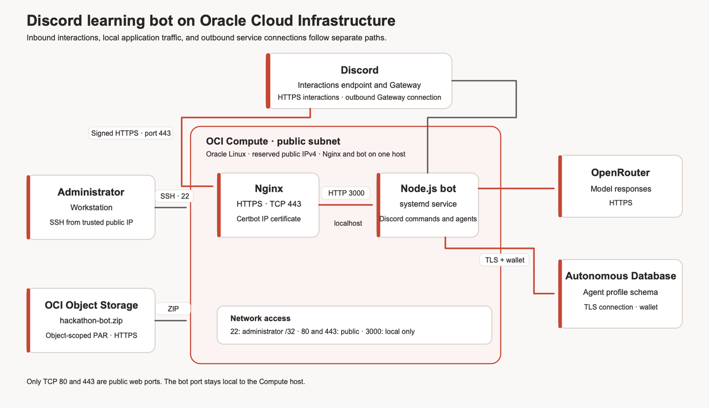

# Build the Discord Learning Bot with Oracle Autonomous Database

## Introduction

Generative AI can do more than respond to a question. When connected to instructions, tools, and trusted data, it can power agents that research a topic, guide a learner through an exercise, or complete a focused task. In this workshop, you will see how an agent combines a language model with application logic and services, while the application controls which actions and data are available.

Oracle Cloud Infrastructure (OCI) provides the foundation for the application: OCI Compute runs the bot, and Oracle Autonomous AI Database stores agent profiles and the LiveLabs workshop catalog, including vector embeddings for meaning-based search. OpenRouter connects the application to language models. Discord provides the interface learners use to interact with the agent. Nginx and Certbot provide the HTTPS endpoint Discord requires, using a reserved public IP without a domain.

Estimated Workshop Time: 120 minutes.

### Objectives

In this workshop, you will:

- Prepare an OCI host, network rules, Autonomous Database, and TLS endpoint.
- Download an approved bot package from OCI Object Storage.
- Configure a Discord application and OpenRouter without committing credentials.
- Set up private database storage and a prevalidated LiveLabs catalog with semantic vector search.
- Run automated production setup and verify all nine commands.

### Prerequisites

- OCI access to create Compute, VCN, Autonomous Database, and Object Storage resources.
- Discord Developer Portal access and a private server where you can install a test bot.
- An OpenRouter API key and a model available to your account.
- Reserve a public IPv4 address. The workshop uses an IP certificate, so you do not need a domain or DNS account.
- The [hackathon-bot ZIP in OCI Object Storage](https://c4u02.objectstorage.us-ashburn-1.oci.customer-oci.com/p/9DEArLjsgbKXuJgQtSG95E8hMXRFtxgHR8jiHbqz4HgyVYXVnSo0SC_s-zq5CJA3/n/c4u02/b/hosted-files/o/hackathon-bot.zip).
- A workstation with a browser, SSH/SFTP client, and a secure password manager.

## Architecture

Keep Compute port 3000 closed to public ingress. Nginx proxies traffic locally to the bot on that port. Permit public TCP 80 for Certbot validation and redirects, and TCP 443 for Discord HTTPS. Keep SSH limited to the administrator IP.

The ZIP excludes `.env`, wallet files, and credentials. Download the wallet from Autonomous Database, transfer it securely to Compute, and create `.env` there. Use synthetic data. Channel members can see bot replies in a server channel.

## The Learning Agent

At the end of the workshop, you will have a Discord learning agent that can answer questions, research topics with sources, prepare study guides and quizzes, and explain Oracle Cloud and Oracle AI Database concepts. It can also query approved database information, find relevant LiveLabs workshops through semantic search, and run reusable, learner-created agents. Together, these capabilities show how Oracle Cloud and Autonomous AI Database can support practical AI applications, from hosting the service to storing agent data and powering vector search.

## Acknowledgements

- Authors: Cyrce Salinas Rojas and Ilan Gómez Guerrero
- Last Updated:  Cyrce Salinas Rojas, November 2026
