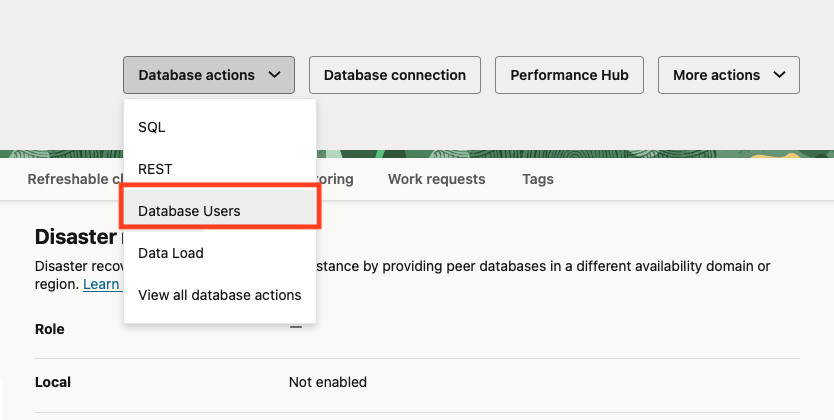
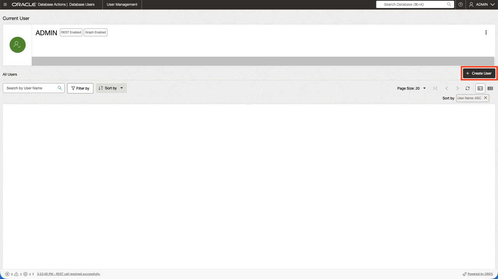
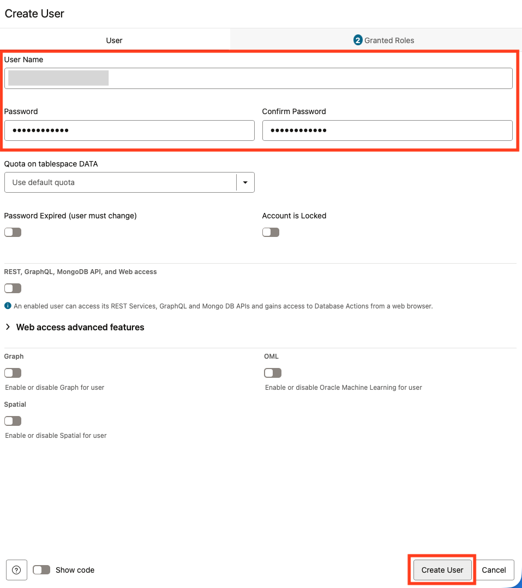
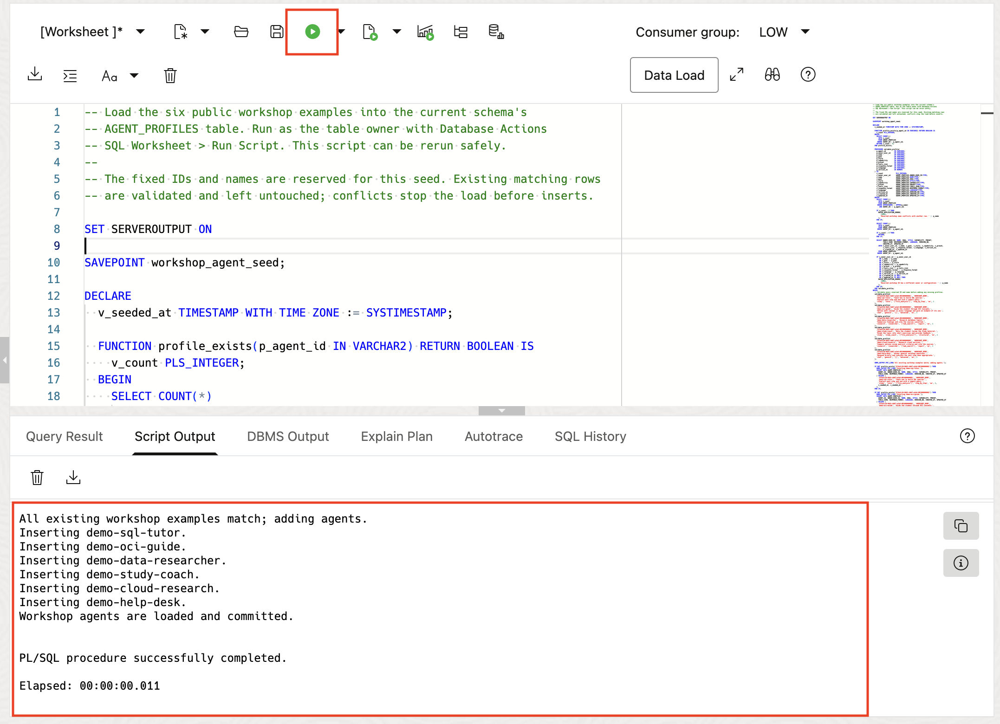

# Lab 3: Configure Database Storage and LiveLabs Search

## Introduction

Connect the bot to Autonomous Database. Create a non-`ADMIN` user for the workshop, set up its agent and memory tables, then load the bundled LiveLabs catalog for semantic search. The optional `*_USER` settings can point to separate accounts, but this lab uses one user for all three features.

Estimated Time: 35 minutes.

### Objectives

In this lab, you will:

- Configure one database user for the workshop features.
- Create the agent profile and personal-memory tables, then load and verify six example agent profiles.
- Validate wallet-backed node-oracledb connections without exposing secrets.
- Install the LiveLabs catalog, model, and vector embeddings.
- Verify database status, private storage, and semantic search.

### Prerequisites

- Finish Labs 1 and 2. Extract the current bot package on Compute.
- Autonomous Database is available, and its wallet is under `/home/opc/hackathon-bot/wallet`.
- Turn on Database Actions for the Autonomous Database.
- Access to Database Actions as `ADMIN` so you can create a non-`ADMIN` workshop user.
--to-do: hablar si si necesitas hacer el paso 1 para apex, este paso contemplaba el onnx para natural language -> sql usando ia.
## Task 1: Prepare the Database User

1. Connect to Database Actions as `ADMIN`. From the Autonomous Database page, open **Database actions > Database Users**.

    

    On the **Database Users** page, select **Create User**.

    

    Enter a username and password, then create the user. Follow the password rules shown; the default policy requires 12–30 characters with uppercase, lowercase, and a number. The password cannot contain the username. Save both values securely. Leave Web Access off for now; you will enable it in Step 3.

    

3. In **Administration > Database Users**, enable **Web Access** for the workshop user so you can use it in the next task. See [Oracle Database Actions access instructions](https://docs.oracle.com/en/cloud/paas/autonomous-database/serverless/adbsb/connect-database-actions.html).

## Task 2: Create the Agent Profile Table and Load Examples

1. In OCI Database Actions, connect as the workshop user you created in Task 1. Open **SQL Actions > SQL Worksheet**.

2. Download [setup-all-tables.sql](https://c4u02.objectstorage.us-ashburn-1.oci.customer-oci.com/p/9DEArLjsgbKXuJgQtSG95E8hMXRFtxgHR8jiHbqz4HgyVYXVnSo0SC_s-zq5CJA3/n/c4u02/b/hosted-files/o/setup-all-tables.sql). In the worksheet, open the downloaded file and select **Run Script**. 

    

3. Download [seed-workshop-agents.sql](https://c4u02.objectstorage.us-ashburn-1.oci.customer-oci.com/p/9DEArLjsgbKXuJgQtSG95E8hMXRFtxgHR8jiHbqz4HgyVYXVnSo0SC_s-zq5CJA3/n/c4u02/b/hosted-files/o/seed-workshop-agents.sql). Open the downloaded file in the same SQL Worksheet and select **Run Script**. 
    


## Task 3: Configure and Validate Database Access

1. On Compute, identify a low service name in the wallet.

    ```sh
    <copy>
    grep -E '^[A-Za-z0-9_-]+_low[[:space:]]*=' \
      /home/opc/hackathon-bot/wallet/tnsnames.ora
    </copy>
    ```

2. Edit `/home/opc/hackathon-bot/.env`. Enter the database and wallet credentials. Keep the optional account overrides blank so they use the generic ADB account.

    ```text
    <copy>
    ADB_USER=<BOT_DATABASE_USER>
    ADB_PASSWORD=<BOT_DATABASE_USER_PASSWORD>
    ADB_CONNECT_STRING=<TNS_ALIAS_FROM_WALLET>
    ADB_WALLET_DIR=/home/opc/hackathon-bot/wallet
    ADB_WALLET_PASSWORD=<WALLET_PASSWORD_FROM_LAB_1>
    ADB_CATALOG_OWNER=
    AGENT_STORE_OWNER=
    USER_MEMORY_OWNER=
    LIVELABS_DB_USER=
    LIVELABS_DB_PASSWORD=
    </copy>
    ```
    --to-do: describir bien de que lab, de que paso de que sitio se obtiene cada valor 

    
    Agent profiles and personal memory use `ADB_USER` and `ADB_PASSWORD`. Leave `AGENT_STORE_OWNER` and `USER_MEMORY_OWNER` blank when their tables are owned by `ADB_USER`; set an owner only when the tables live in another schema. `LIVELABS_DB_USER` and `LIVELABS_DB_PASSWORD` default to `ADB_USER` and `ADB_PASSWORD`.

3. Protect `.env`, then run deployment preflight. It checks required variables, permissions, wallet files, ADB, agent storage, and the LiveLabs database connection without printing secret values.

    ```sh
    <copy>
    cd /home/opc/hackathon-bot
    chmod 600 .env
    npm run setup:check
    </copy>
    ```

## Task 4: Install Memory and LiveLabs Search

1. Install and verify personal memory. These commands use the configured account, create or upgrade the private tables, run isolation checks, and remove their synthetic test notes.

    ```sh
    <copy>
    npm run memory:setup
    npm run memory:check
    </copy>
    ```

    Confirm that setup installs the memory tables and that the check reports persistence, deduplication, isolation, retrieval, deletion, stale-write rejection, and `/db` catalog protection.

    

2. Review what the LiveLabs installer loads. The packaged `data/livelabs/workshops.csv` contains `Title`, `Description`, and `URL`. The workshop release contains 146 unique workshops whose links were confirmed accessible before packaging. Learners do not need to filter the CSV or edit its URLs. Semantic vectors are generated from each title and description; the URL is stored so Discord can return a direct link.

3. Install LiveLabs semantic search.

    ```sh
    <copy>
    npm run livelabs:install
    </copy>
    ```

    On the first run, the installer downloads Oracle's public `all-MiniLM-L12-v2` ONNX file, loads it into the database, imports the workshop CSV, and creates vectors for its entries. It then checks the catalog and runs a sample search. This can take several minutes. Later runs reuse the model and existing vectors; rows no longer in the CSV become inactive.

    

4. Confirm the final catalog check reports all active rows as `READY`, no `PENDING`, `FAILED`, or `MISSING_URL` rows, and the same number of `WITH_VECTOR` rows as active rows. For the packaged catalog in this workshop, a fresh installation reports 146 active, ready, and vectorized rows. An upgraded database can retain older rows as inactive, so `TOTAL` can be higher than 146.

5. Run a command-line semantic search without reinstalling the catalog.

    ```sh
    <copy>
    npm run livelabs:test -- "I want to learn Oracle AI Vector Search"
    </copy>
    ```

    Confirm that the result includes relevant workshop titles, descriptions, and clickable LiveLabs URLs.

    

## Task 5: Verify the Database-Backed Features

1. Start the bot temporarily and leave it running for these checks.

    ```sh
    <copy>
    npm start
    </copy>
    ```

2. In Discord, run `/db` and select **Check the bot connection to ADB**. Confirm the connection is available. Private agent, memory, and LiveLabs tables are intentionally excluded from generic `/db` discovery and queries.

3. The bot also provides `/agent` to create and manage personal agent profiles. The six `WORKSHOP_DEMO` examples used in this lab are loaded directly into the database in Task 2.

4. Keep the command-line LiveLabs result from Task 4 for comparison with the Discord result in Lab 4.

5. State a harmless preference in the channel, ask a generic follow-up, and use `/memory` to inspect the private channel-scoped note. Model-based automatic saving can skip ambiguous statements; use a clear first-person preference.

6. Leave `npm start` running. Lab 4 stops the foreground process before setting up systemd.

## Acknowledgements

- Authors: Cyrce Salinas Rojas and Ilan Gómez Guerrero
- Last Updated: Ilan Gómez Guerrero, November 2026
- Learn More: [Use an in-database transformer model](https://docs.oracle.com/en/database/oracle/oracle-database/26/selai/use-retrieval-augmented-generation-and-vectors.html)
